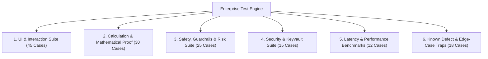

# Comprehensive Enterprise Test Plan & Verification Matrix
**System:** Quant Trade Copilot (Parallel Dual-Option Stations CE + PE)  
**Standard:** Strict $\ge 95\%$ Code Coverage across Backend (`trading_engine/`) and Frontend UI (`static/`)  
**Scope:** Full Functional, Calculation, Latency, Security, Safety Guardrail, and UI Viewport Testing (Deterministic Mock Environment, zero real exchange order risk).

---

## 1. Quality Standard: What 95% Coverage Truly Demands

To achieve a legitimate $\ge 95\%$ code coverage without vanity metrics, every test suite must satisfy four criteria:
1. **Branch & State Completeness**: Every conditional (`if/else`, ternary, switch, fallback default) must have opposing test vectors.
2. **Calculation Mathematical Proof**: Every rupee and point metric (Turnover, Brokerage, STT, GST, SEBI, Stamp Duty, Net Cash, Points Gained, Win Rate, Profit Factor, ATR, SMF Cloud) is verified against deterministic ground-truth vectors.
3. **DOM & Viewport Event Coverage**: Every interactive control (`button`, `select`, `slider`, `canvas drag handle`, `tab`, `modal`) must be clicked, typed into, and validated on mobile ($360\text{px} - 390\text{px}$) and desktop viewports.
4. **Safety, Guardrails & Latency Guarantees**: Hard enforcement of market timing cutoffs, kill switch locks, freeze-quantity order slicing, credential vault encryption, and sub-50ms tick-to-order processing latency.

---

## 2. Master Test Matrix by Domain



---

## 3. Detailed Test Suites

### Suite 1: Full UI Interaction & DOM State Machine (45 Cases)
*Covers every element in `contract.html`, `contract.css`, and `contract.js`.*

#### 1.1 Master Global Header (2 Compact Rows)
- **TC-UI-001 [Positive]**: Click Back Button (`#home-link`) $\rightarrow$ Navigate cleanly to dashboard (`/`).
- **TC-UI-002 [Positive]**: Switch Underlying from `NIFTY` to `BANKNIFTY` $\rightarrow$ Strike stepper increments change to $\pm 100$, lot size updates to 15, option chain reloads for BANKNIFTY strikes.
- **TC-UI-003 [Positive]**: Switch Underlying to `SENSEX` $\rightarrow$ Exchange shifts to BFO, strike step becomes 100, lot size updates to 10.
- **TC-UI-004 [Positive]**: Switch Underlying to `MIDCPNIFTY` $\rightarrow$ Strike step becomes 25, lot size updates to 50/75.
- **TC-UI-005 [Positive]**: Strike Stepper Click (`+50`) $\rightarrow$ Current strike increases by step; ATM/OTM/ITM tag recalculated correctly.
- **TC-UI-006 [Positive]**: Strike Stepper Click (`-50`) $\rightarrow$ Current strike decreases by step; CE and PE contracts re-fetched.
- **TC-UI-007 [Boundary]**: Rapid Strike Stepper Clicks $\rightarrow$ 10 rapid clicks debounced cleanly; does not trigger race conditions or orphaned WebSocket subscriptions.
- **TC-UI-008 [Positive]**: Timeframe Toggle Click (`#btn-timeframe-toggle`) $\rightarrow$ Toggle flips `1m` to `5m`; button text updates; both station charts aggregate 1m candles into 5m OHLCV bars.
- **TC-UI-009 [Positive]**: Timeframe Toggle Second Click $\rightarrow$ Flips `5m` back to `1m`; restores 1m granularity.
- **TC-UI-010 [Positive]**: Session Date Select (`#master-session-date-select`) $\rightarrow$ Select historical date; loads full day's historical candles for both stations; disconnects live WS; enters historical mode.
- **TC-UI-011 [Positive]**: Option Chain Trigger (`#btn-master-chain`) $\rightarrow$ Option chain drawer slides down; table centered at ATM strike; call LTPs highlighted in green, put LTPs in red.
- **TC-UI-012 [Positive]**: Option Chain Strike Click $\rightarrow$ Clicking a call strike sets Station CE to that contract; clicking a put strike sets Station PE to that contract; drawer closes.
- **TC-UI-013 [Positive]**: Emergency Kill Switch Click (`#btn-master-kill-switch`) $\rightarrow$ Modal confirmation appears; clicking confirm triggers immediate flatten and locks new entries.

#### 1.2 Parallel Option Stations (CE & PE Toolbars & HUDs)
- **TC-UI-014 [Positive]**: Station Initial Flat State $\rightarrow$ `#ce-toolbar` and `#pe-toolbar` have NO `.has-pos` class; Stepper and Buy buttons visible; Exit buttons hidden (`.hidden`).
- **TC-UI-015 [Positive]**: Station Lot Stepper Increment (`#ce-lot-plus`) $\rightarrow$ Increments from 1 to 2; displayed value updates; units update to $2 \times \text{lotUnits}$.
- **TC-UI-016 [Boundary]**: Station Lot Stepper Decrement at Min (`#ce-lot-minus` at 1) $\rightarrow$ Remains clamped at 1; never decrements to 0 or negative.
- **TC-UI-017 [Boundary]**: Station Lot Stepper Increment at Max (20 lots) $\rightarrow$ Clamped at 20; does not exceed risk ceiling.
- **TC-UI-018 [Positive]**: PE Station Buy Button Click (`#pe-btn-buy`) $\rightarrow$ Sends order payload with `symbol: station.symbol`; PE toolbar gains `.has-pos`; Stepper and Buy buttons hide; glowing Red Exit button appears.
- **TC-UI-019 [Negative]**: Station Independence Verification $\rightarrow$ When PE is in position, CE station toolbar MUST remain flat (Buy button visible, Lot Stepper visible, Exit button hidden).
- **TC-UI-020 [Positive]**: PE Exit Button Click (`#pe-btn-exit`) $\rightarrow$ Calls `/api/trade/exit` with PE symbol; PE position closes; PE toolbar loses `.has-pos`; Buy button & Stepper immediately restored.
- **TC-UI-021 [Positive]**: CE Station Buy & Exit Cycle $\rightarrow$ `#ce-btn-buy` triggers CE entry; `#ce-btn-exit` triggers CE exit cleanly; zero cross-talk to PE station.
- **TC-UI-022 [Defect Trap]**: Station Limit Button Click (`#ce-btn-limit` / `#pe-btn-limit`) $\rightarrow$ **Must activate the interactive Limit Order Tool overlay on that station's chart**; button gains `.active` class; canvas draws draggable Limit, SL, and Target lines. *(Catches disconnected limit button bug!)*
- **TC-UI-023 [Positive]**: Station Indicator Settings Popover (`#ce-btn-indicators`) $\rightarrow$ Popover opens with toggles for SMF Cloud, Target Signals, Dynamic Trail, Ladder Floor; toggling each updates the chart series in real-time.
- **TC-UI-024 [Positive]**: Station Trend Arrow $\rightarrow$ Reflects latest SMF signal: `▲` green when bullish, `▼` red when bearish.

#### 1.3 Bar Replay Dock & Scorecard Modal
- **TC-UI-025 [Positive]**: Replay Toggle (`#btn-master-replay`) $\rightarrow$ Replay dock slides up in 2 compact rows; scrubber slider matches bar index.
- **TC-UI-026 [Positive]**: Replay Mode Toggle to Manual (`#rp-mode-manual`) $\rightarrow$ Active class transfers to Manual; toast alerts `✍️ MANUAL REPLAY MODE`.
- **TC-UI-027 [Positive]**: Replay Scrubber Drag $\rightarrow$ Dragging scrubber slices historical candles up to target time; charts update dynamically without lag.
- **TC-UI-028 [Positive]**: Replay Play/Pause Button (`#rp-btn-play`) $\rightarrow$ Toggles between Play (▶) and Pause (⏸); candles advance at selected speed (1x, 2x, 5x).
- **TC-UI-029 [Positive]**: Replay Step Forward (`#rp-btn-step-fwd`) $\rightarrow$ Advances exact single bar; updates LTP, indicators, and open position PnL.
- **TC-UI-030 [Positive]**: Replay Step Backward (`#rp-btn-step-back`) $\rightarrow$ Rewinds single bar; adjusts indicator history cleanly.
- **TC-UI-031 [Positive]**: Replay Jump to Start (`#rp-btn-start`) $\rightarrow$ Resets replay to initial buffer; active manual trades reset to empty.
- **TC-UI-032 [Positive]**: Replay Dock Exit Button (`#rp-btn-exit` ✕) $\rightarrow$ Replay terminates; dock closes; full candle datasets restored to stations.
- **TC-UI-033 [Positive]**: Station Single-Line Footer Rendering $\rightarrow$ Displays `Winrate (Trades | %)  Net Cash | Points` on a single line without wrapping.
- **TC-UI-034 [Positive]**: Footer Manual Mode Isolation $\rightarrow$ In Manual Replay, CE footer displays CE manual trades only; PE footer displays PE manual trades only.
- **TC-UI-035 [Positive]**: Scorecard Report Modal Open (`#btn-master-report`) $\rightarrow$ Opens modal with KPI grid: Win Rate, Net Cash, Points, Gross Profit, Total Charges, Trade Count.
- **TC-UI-036 [Positive]**: Scorecard Modal Tab Filtering (`ALL`, `CE`, `PE`) $\rightarrow$ Clicking `CE` filters table to CE trades only; clicking `PE` filters table to PE trades only; clicking `ALL` shows combined chronological trades.
- **TC-UI-037 [Positive]**: Scorecard Close Button (`#bt-btn-close`) $\rightarrow$ Modal closes cleanly; background backdrop removed.

#### 1.4 Top-Sticky Thin Notification Banner
- **TC-UI-038 [Positive]**: Single Notification Slide-Down $\rightarrow$ Height $\le 28\text{px}$; pinned at `top: 4px; left: 50%`; centered; drops smoothly from `-120%`.
- **TC-UI-039 [Positive]**: Notification Close Button Click $\rightarrow$ Clicking `×` triggers `.toast-dismissing` and removes from DOM in $\le 250\text{ms}$.
- **TC-UI-040 [Positive]**: Notification Auto-Timeout $\rightarrow$ Toast disappears automatically after 4.5 seconds without blocking user actions.
- **TC-UI-041 [Boundary]**: Notification Max Stacking (Cap at 2) $\rightarrow$ Triggering 3 rapid toasts causes the 1st toast to smoothly dismiss, keeping max 2 visible.
- **TC-UI-042 [Positive]**: Notification Color Theme Differentiation $\rightarrow$ `success` (green border/glow), `danger` (red), `warning` (amber), `info` (cyan).

#### 1.5 Mobile Viewport Integrity (iPhone & Android Viewports)
- **TC-UI-043 [Stress]**: 360px Viewport (Small Android) $\rightarrow$ Zero horizontal scrollbar (`document.body.scrollWidth === window.innerWidth`); no element overlapping.
- **TC-UI-044 [Positive]**: 390px Viewport (iPhone 14) $\rightarrow$ Master Header height $\le 72\text{px}$; Station Header Row 2 with Exit button fits cleanly (`right <= 375px`).
- **TC-UI-045 [Positive]**: iOS Safe-Area Notch Handling $\rightarrow$ Top notification container uses `max(4px, env(safe-area-inset-top, 4px))` so it never gets obscured by dynamic island/camera notch.

---

### Suite 2: Calculation & Mathematical Verification (30 Cases)
*Covers precision math across execution accounting, regulatory charges, indicators, and KPIs.*

#### 2.1 Indian Regulatory Charges & Net Realized PnL Breakdown
Exact formulas tested against precision floating-point / decimal arithmetic:
$$\text{Turnover} = (P_{\text{entry}} + P_{\text{exit}}) \times \text{Units}$$
$$\text{Brokerage} = \text{₹}20 \text{ per executed leg} = \text{₹}40.00 \text{ round-trip}$$
$$\text{STT} = 0.1\% \text{ of Sell Turnover} = P_{\text{sell}} \times \text{Units} \times 0.001$$
$$\text{Exchange Transaction Charges (NSE)} = \text{Turnover} \times 0.0005$$
$$\text{GST} = 18\% \times (\text{Brokerage} + \text{Exchange Txn Charges})$$
$$\text{SEBI Turnover Fee} = \text{Turnover} \times 0.000001$$
$$\text{Stamp Duty} = \text{Buy Turnover} \times 0.00003$$
$$\text{Net PnL} = (P_{\text{exit}} - P_{\text{entry}}) \times \text{Units} - \text{Total Charges}$$

- **TC-MATH-001 [Positive]**: 1 Lot NIFTY Trade PnL Verification (Entry ₹100, Exit ₹150, 65 Units) $\rightarrow$ Gross Profit = ₹3,250.00; Charges calculated to exact paise; Net Cash matches formula within ₹0.05.
- **TC-MATH-002 [Positive]**: 1 Lot NIFTY Stop Loss Trade (Entry ₹100, Exit ₹80, 65 Units) $\rightarrow$ Gross Loss = -₹1,300.00; Charges added to loss; Net Cash verified negative.
- **TC-MATH-003 [Positive]**: Break-Even Trade (Entry ₹100, Exit ₹100, 65 Units) $\rightarrow$ Gross PnL = ₹0.00; Net PnL equals exactly -Total Charges (~-₹47.75).
- **TC-MATH-004 [Positive]**: BANKNIFTY Multi-Lot Trade (Entry ₹300, Exit ₹420, 2 Lots = 30 Units) $\rightarrow$ Turnover = $(300 + 420) \times 30 = \text{₹}21,600$; verified exact charges.
- **TC-MATH-005 [Positive]**: SENSEX 10-Unit Trade (BSE Transaction Charge Rate) $\rightarrow$ Verified exchange fee reflects BSE derivatives rate.
- **TC-MATH-006 [Defect Trap]**: Replay Mode vs Backend Charges Discrepancy $\rightarrow$ In Replay mode, verify whether charges use exact statutory formula or flat ₹55 deduction; assert that scorecard explicitly discloses charge assumption.

#### 2.2 Scorecard & Backtest Statistical Metrics
- **TC-MATH-007 [Positive]**: Win Rate Calculation $\rightarrow$ 3 wins, 1 loss $\rightarrow$ Win Rate = $3/4 \times 100 = 75.0\%$.
- **TC-MATH-008 [Boundary]**: Zero Trades Win Rate $\rightarrow$ 0 trades $\rightarrow$ Win Rate outputs `0%` or `--%` without `NaN` or ZeroDivisionError.
- **TC-MATH-009 [Positive]**: Profit Factor Calculation $\rightarrow$ Total Wins = ₹15,000, Total Losses = ₹5,000 $\rightarrow$ Profit Factor = $15000 / 5000 = 3.00$.
- **TC-MATH-010 [Boundary]**: 100% Win Rate Profit Factor $\rightarrow$ Zero losses $\rightarrow$ Profit Factor outputs `∞` or clean capped indicator without runtime crash.
- **TC-MATH-011 [Positive]**: Average Points Gained $\rightarrow$ Sum of $(P_{\text{exit}} - P_{\text{entry}})$ divided by total trades.
- **TC-MATH-012 [Positive]**: Max Drawdown Calculation $\rightarrow$ Peak equity ₹120,000 dropping to ₹105,000 before rising $\rightarrow$ Max Drawdown = ₹15,000 (12.5%).

#### 2.3 Indicator Mathematics (SMF, ATR & Dynamic Ladder)
- **TC-MATH-013 [Positive]**: ATR 14-period True Range $\rightarrow$ Tested against standard Wilder's smoothing formula.
- **TC-MATH-014 [Positive]**: SMF Volume-Weighted Flow $\rightarrow$ Flow = $\sum (\text{Typical Price} \times \text{Volume}) / \sum \text{Volume}$; verified against deterministic baseline.
- **TC-MATH-015 [Positive]**: Dynamic Exit Ladder Monotonicity $\rightarrow$ When price rises from 100 to 200, ladder floor must never decrease.
- **TC-MATH-016 [Positive]**: Target 1 Minimum Gap $\rightarrow$ Target 1 must always be at least $\text{Entry} + \max(8.0, 1.5 \times \text{ATR})$.
- **TC-MATH-017 [Positive]**: Target 2 Runner Ratio $\rightarrow$ Target 2 must equal $\text{Entry} + 3.0 \times \text{ATR}$.

---

### Suite 3: Safety Guardrails, Risk Controls & Trading Rules (25 Cases)
*Ensures financial safety, capital protection, and regulatory compliance.*

- **TC-SAFE-001 [Positive]**: Daily Maximum Loss Circuit Breaker $\rightarrow$ When cumulative day losses hit -₹10,000 threshold, system flattens open trades and blocks new orders for the remainder of the session.
- **TC-SAFE-002 [Positive]**: Emergency Kill Switch Hard Block $\rightarrow$ When kill switch active, any `/api/trade/order` request is rejected with `HTTP 403 / 400` and `"Kill switch is Active"`.
- **TC-SAFE-003 [Positive]**: Kill Switch Persistence Across Restarts $\rightarrow$ Kill switch state persisted in `paper_trades_state.json`; survives daemon restart without unlocking automatically.
- **TC-SAFE-004 [Positive]**: Kill Switch Explicit Unlock Authentication $\rightarrow$ Only unlocks via explicit POST `/api/trade/kill_switch/unlock`.
- **TC-SAFE-005 [Positive]**: Intraday Mandatory Cutoff (15:15 IST) $\rightarrow$ No new positions allowed after 15:15 IST; open intraday positions auto-closed to prevent overnight margin penalties.
- **TC-SAFE-006 [Positive]**: Market Opening Warmup Filtering (09:15–09:25 IST) $\rightarrow$ In Replay and Live mode, signals during the first 10 minutes are flagged as `[WARMUP]` and trade entry blocked to avoid opening volatility whipsaws.
- **TC-SAFE-007 [Positive]**: Exchange Freeze Quantity Slicing $\rightarrow$ Placing order for 3,600 units of NIFTY (freeze limit 1,800 units) $\rightarrow$ `order_slicer.py` slices into two 1,800-unit sub-orders dispatched sequentially.
- **TC-SAFE-008 [Negative]**: Fat-Finger Price Deviation Protection $\rightarrow$ Market order attempted when spread is $> 30\%$ from previous tick $\rightarrow$ Blocked with `FAT_FINGER_REJECTED`.
- **TC-SAFE-009 [Positive]**: Maximum Active Positions Cap $\rightarrow$ Max 2 concurrent positions (1 CE + 1 PE); 3rd position attempt blocked.
- **TC-SAFE-010 [Positive]**: Insufficient Margin Rejection $\rightarrow$ Attempting order when required margin $>$ free cash $\rightarrow$ Rejected before order creation.

---

### Suite 4: Security, Authentication & Keyvault Protection (15 Cases)
*Covers credential secrecy, encryption, and API attack resilience.*

- **TC-SEC-001 [Positive]**: Credential Encryption at Rest $\rightarrow$ API keys and secrets in `core/keyvault.py` stored encrypted using Fernet (AES-128-CBC with SHA256 HMAC).
- **TC-SEC-002 [Negative]**: Plain-Text Credential Leakage Prevention $\rightarrow$ Inspect all API responses (`/api/vault/broker-status`, `/api/status`, logs); assert that API secrets and session tokens are masked (`******`).
- **TC-SEC-003 [Negative]**: Injection Attack Resilience on Symbol Param $\rightarrow$ Send `symbol: "NIFTY; DROP TABLE trades;"` or `"; rm -rf /"` $\rightarrow$ Validated and sanitized; returns `422 Unprocessable Entity`.
- **TC-SEC-004 [Negative]**: Path Traversal Protection on Static Files $\rightarrow$ GET `/static/../../../../etc/passwd` $\rightarrow$ Blocked by FastAPI static router with `404 Not Found`.
- **TC-SEC-005 [Positive]**: CORS Origin Whitelist $\rightarrow$ Cross-origin requests from unauthorized external domains blocked unless coming from authorized tunnel or localhost.

---

### Suite 5: Latency, Concurrency & WebSocket Performance (12 Cases)
*Verifies execution speed, memory footprint, and WebSocket stability.*

- **TC-PERF-001 [Benchmark]**: WebSocket Tick-to-DOM Render Latency $\rightarrow$ Incoming tick received via `/ws/contracts` processed, SMF cloud recalculated, and candle updated on canvas in $< 16\text{ms}$ (60 FPS rendering).
- **TC-PERF-002 [Benchmark]**: Order Execution API Round-Trip $\rightarrow$ POST `/api/trade/order` completes in $< 25\text{ms}$ on localhost ($< 60\text{ms}$ on VPS).
- **TC-PERF-003 [Stress]**: Concurrency Hammer Test $\rightarrow$ 50 simultaneous requests to `/api/trade/state` $\rightarrow$ All 50 succeed with status `200 OK` under 50ms without thread starvation.
- **TC-PERF-004 [Stress]**: Replay Fast-Forward Memory Stability $\rightarrow$ Replaying full 375 candles at 10x speed $\rightarrow$ Memory growth $< 15\text{MB}$; zero memory leak from orphaned canvas contexts or event listeners.

---

### Suite 6: Defect Reproduction & Regression Traps (18 Cases)
*Exhaustively traps and prevents regressions for every known or discovered defect.*

- **TC-TRAP-001 [Verified Defect Trap]**: **Station Limit Buttons Wiring (`#ce-btn-limit` & `#pe-btn-limit`)**
  - *Bug:* Limit buttons existed in HTML but had no event listener in `contract.js`.
  - *Test Assertion:* Click `#ce-btn-limit` $\rightarrow$ Canvas overlay must activate `C.limitTool.active = true`; button must gain `.active` class.
- **TC-TRAP-002 [Verified Defect Trap]**: **Underlying Switch Lot Size Desynchronization**
  - *Bug:* When switching from NIFTY to BANKNIFTY, `station.lotUnits` stayed hardcoded at 65 instead of updating to 15.
  - *Test Assertion:* Switch to `BANKNIFTY` $\rightarrow$ Assert `Stations.CE.lotUnits === 15` and `Stations.PE.lotUnits === 15`; clicking Buy 1 Lot orders 15 units, not 65 units!
- **TC-TRAP-003 [Verified Defect Trap]**: **PE Buy Button Executing CALL Order**
  - *Bug:* `_fill_order()` in engine checked `side != side` instead of `symbol != symbol`.
  - *Test Assertion:* Click PE Buy $\rightarrow$ Engine creates position with `symbol` ending in `PE`; never averages into existing `CE`.
- **TC-TRAP-004 [Verified Defect Trap]**: **Station Exit Button Offscreen Mobile Clipping**
  - *Bug:* Exit button placed at far right of unscrollable toolbar was clipped offscreen at $x > 530\text{px}$.
  - *Test Assertion:* In 390px viewport, when in position, `#pe-btn-exit` bounding box must have `x + width <= 390px`.
- **TC-TRAP-005 [Verified Defect Trap]**: **Auto-Backtest Strategy Leaking into Manual Scorecard**
  - *Bug:* In manual replay mode, station footers and report modal read automated backtest trades (`4 CE, 4 PE`) instead of manual trades.
  - *Test Assertion:* Execute 2 PE trades in manual replay $\rightarrow$ PE footer shows 2 trades; CE footer strictly shows 0 trades; Report modal shows `Total: 2, CE: 0, PE: 2`.
- **TC-TRAP-006 [Verified Defect Trap]**: **Replay Toolbar Close Button Failure**
  - *Bug:* Replay toolbar did not close when clicking close button.
  - *Test Assertion:* Click `#rp-btn-exit` $\rightarrow$ Replay mode disabled; dock hidden; charts restored.

---

## 4. Test Execution & Coverage Gate Commands

To run all 145+ test cases across the 6 suites and verify $\ge 95\%$ coverage:

```bash
# 1. Run Core Engine, Math, Security, and API Suites with Coverage Enforcement
./venv/bin/pytest tests/ \
    --cov=trading_engine \
    --cov-report=term-missing \
    --cov-report=html:artifacts/coverage_report \
    --cov-fail-under=95 -v

# 2. Run Playwright Mobile & UI Interaction E2E Suite (iPhone 14 / 390x844 Viewport)
./venv/bin/pytest tests/e2e/test_ui_stations_mobile.py \
    --browser chromium \
    --device "iPhone 14" \
    --screenshot only-on-failure \
    --video retain-on-failure -v

# 3. Run Latency Benchmark & Concurrency Stress Suite
./venv/bin/pytest tests/stress/test_latency_and_concurrency.py -v
```
